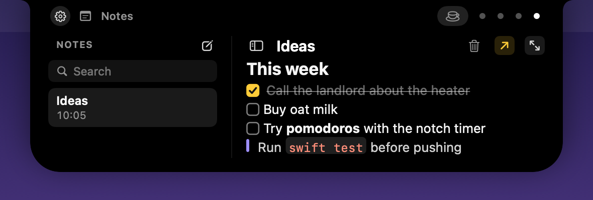
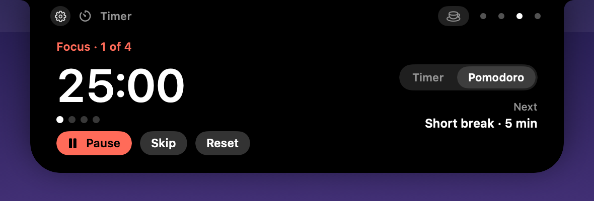

# Ledge

A Dynamic Island for your Mac's notch. Ledge turns the notch on a MacBook (and a small pill on external displays) into a live strip for music, meetings, timers and indicators, and opens into a panel for your calendar, to-dos and notes.

<p align="center"></p>

It's free, open source (MIT) and native: Swift, SwiftUI and AppKit, with no accounts, no tracking and no network services of its own. Your calendar, to-dos and notes stay in Apple's own apps (Calendar, Reminders and Notes), so they sync to your iPhone the way they always have.

**Contents:** [Features](#features) · [Requirements](#requirements) · [Install](#install) · [Permissions and privacy](#permissions-and-privacy) · [Shortcuts](#keyboard-shortcuts) · [Troubleshooting](#troubleshooting) · [How it works](#how-it-works) · [Contributing](#contributing) · [License](#license)

## Features

### Music in the notch

When something plays (Apple Music, Spotify, a browser tab, anything that shows in Control Center), the notch widens to show the album art and a waveform. Open the island to scrub, pause and skip; in the closed island, a two-finger swipe skips tracks.

<p align="center"></p>

### Calendar and to-dos

The Calendar page shows today's date and your next events, with **Join** for Zoom, Meet, Teams and Webex links; click an event to open it in Calendar. The **Events · To-dos** switch shows your open reminders from every list, with steps (`- [ ]` lines in a reminder's notes), in-progress and "must" markers.

<p align="center"></p>

**Quick add** turns one line into an event or reminder: press **⌃⌥E** (event) or **⌃⌥T** (to-do) from anywhere, or click **+**. A preview shows what Ledge understood before you press return.

| You type | You get |
| --- | --- |
| `Dentist tomorrow 3pm` | An event tomorrow at 3 pm |
| `Gunma trip jan 20 2027 to jan 25 2027` | A multi-day event |
| `Gym every weekend from 5 to 8` | A repeating 5–8 pm event on Saturdays and Sundays |
| `remind me to charge the laptop in 3 hours` | A reminder with an alarm in 3 hours |
| `! Reply to the review fri #work [30m]` | A must-do reminder due Friday, in your "work" list, with a 30 min estimate |

It also understands ISO dates (`2027-01-20`), "in 3 days", "next week", "until dec 2027", "weekdays", "every 2 weeks", "monthly" and more. ⌘Z undoes a save.

### Meeting heads-up

Five minutes before a meeting, a countdown in its calendar color sits beside the notch. A minute before, a pill drops down with **Join** (or **Open** for a meeting without a link). All-day events, declined meetings and long blocks are skipped. Try it from settings → Indicators.

<p align="center">
  
  
</p>

### Notes

Your notes live in Apple Notes (in a folder called **Ledge**), so they're on your iPhone too. The editor draws Markdown as you type: headings, bold and italic, checkboxes you can tick, lists, quotes, inline code and code blocks. The marks show again on the line you're editing. **⌘E** enlarges a note into a big card in the middle of the screen for longer writing. Optional **Vim motions** (settings → Text editor) cover counts, motions, operators, text objects and visual mode.

<p align="center"></p>

### Timer and Pomodoro

A countdown timer and a Pomodoro cycle (focus, short breaks, a long break), with the time beside the notch while it runs and a pop when a phase ends.

<p align="center">
  
  
</p>

### Window switcher

Hold **⌥** and press **Tab** (or set any shortcut, ⌘Tab included) and every window comes out of the notch: two Chrome windows show as two, and windows on other desktops and in full screen are included. Four looks: Strip, Grid, Focus and List. Previews need the Screen Recording permission; without it, the switcher shows app icons.

### And more

- **Indicators:** volume, brightness, charging and low battery show in the notch instead of the macOS pop-ups.
- **Tray:** drop up to 5 files on the notch to keep them handy, then drag them out anywhere (**⌃⌥F** shows the tray).
- **Stay awake:** the coffee cup keeps your Mac awake for a set time, like `caffeinate`.
- **External displays:** screens without a notch get a floating pill with the same features. It stays off full-screen desktops, and fades in when you point at the top edge.
- **Animations:** four styles (Calm, Stretch, Drop down, Morph and blur), and a trackpad tick when the island opens.

<p align="center"> </p>

## Requirements

- A Mac with Apple silicon and macOS 15 or later. It works best on a MacBook with a notch; other screens get the floating pill.
- To build it: Xcode with Swift 6. Ledge is built and tested with Xcode 27 (Swift 6.4) on macOS 27.

There's no downloadable app yet: you build it from source, which takes a minute or two.

## Install

```bash
git clone https://github.com/sabi1125/Ledge.git
cd Ledge
scripts/install.sh
```

`install.sh` builds a release copy, puts it in `/Applications`, and opens it. Ledge then asks for the permissions it needs (see below), and opens at login (switch that off with **Open at login** in settings → General).

To **update**, use **Check for updates** in settings → General, which pulls the latest version and reinstalls it, or run `scripts/install.sh` again.

### Signing your builds (recommended)

macOS ties permissions like Accessibility to an app's signature. Without a signing certificate, Ledge is signed ad hoc, and every new build looks like a different app to macOS, so you'd grant Accessibility again after each update. To avoid that, make a free self-signed certificate once:

1. Open **Keychain Access**, then choose **Keychain Access → Certificate Assistant → Create a Certificate…**
2. Name it exactly **Ledge Local Signing**, set **Certificate Type** to **Code Signing**, and click **Create**.
3. Build again with `scripts/install.sh`. The build finds the certificate by its name and uses it from then on.

The first build with it may ask whether `codesign` can use the key; click **Always Allow**. If the build stops with `errSecInternalComponent`, see [Troubleshooting](#troubleshooting).

## Permissions and privacy

Ledge asks only for what a feature needs, and each feature works without the others.

| Permission | Used for | Without it |
| --- | --- | --- |
| Accessibility | The window switcher, the volume and brightness keys, the menu bar hider | Those features stay off; the keys work as usual with the macOS pop-ups |
| Screen Recording | Window previews in the switcher | The switcher shows app icons |
| Calendar | Events, quick add, the meeting heads-up | The Calendar page asks for access |
| Reminders | To-dos | The To-dos side asks for access |
| Automation (Notes) | The Notes page reads and writes the "Ledge" folder in Apple Notes | The Notes page explains how to allow it |

What stays where:

- Ledge has no servers, accounts or analytics. The only network request it makes itself is `git fetch` when you check for updates.
- Window previews are kept in memory and never saved to disk.
- The log (`~/Library/Logs/Ledge.log`) records problems only, unless you turn on verbose logging. Remove titles before sharing it, since it can include window, song or event names.

## Keyboard shortcuts

| Shortcut | What it does |
| --- | --- |
| ⌘L | Open or close the island, from anywhere |
| ⌃⌥E / ⌃⌥T | Quick add an event / a to-do, from anywhere |
| ⌃⌥F | Show or hide the tray |
| ⌥Tab | Window switcher (changeable, ⌘Tab included) |
| ⌘1–⌘4 | Switch pages while the island is open |
| ⌘N | New event (Calendar page) or new note (Notes page) |
| ⌘T | New to-do (on the to-do list) |
| ⌘E | Enlarge the note, or put it back |
| ⌥⌘S | Show or hide the notes list |
| ⌘, | Settings |
| Esc | Step back, or close the island |
| ⌃⌥⌘M | Show the hidden menu bar icons for 8 seconds (with the menu bar hider on) |

⌘L is taken from every app while Ledge runs, including the browser's "go to the address bar".

## Troubleshooting

**The build stops with "✗ Signing failed" and `errSecInternalComponent`.** macOS wants your permission for `codesign` to use the certificate. Click **Always Allow** if a keychain prompt shows, or allow it for good by running this once (it asks for your login password):

```bash
security set-key-partition-list -S apple-tool:,apple:,codesign: -s ~/Library/Keychains/login.keychain-db
```

**A permission keeps getting asked for again after every update.** Your builds are signed ad hoc. Make the certificate in [Signing your builds](#signing-your-builds-recommended).

**The switcher or the volume keys don't react.** Check System Settings → Privacy & Security → Accessibility, and switch Ledge off and on again there (each ad-hoc build needs a new grant). Quit other window switchers (AltTab, BetterCmdTab…), since the first app to catch the keys wins.

**Something stopped working after a macOS update.** Some features rely on private macOS functions, which an update can change. Ledge checks them at launch and logs what's missing:

```bash
grep "private APIs" ~/Library/Logs/Ledge.log | tail -1
```

**The Notes page says it's waiting for the Notes app.** Notes can take several seconds to answer after it's been idle; Ledge keeps anything you type meanwhile.

**More detail in the log.** Turn on verbose logging, restart Ledge, and look at `~/Library/Logs/Ledge.log`:

```bash
defaults write local.sabir.ledge verboseLog -bool true
```

**Uninstalling.** Quit Ledge (right-click the notch → Quit Ledge), delete `/Applications/Ledge.app`, and remove it from System Settings → General → Login Items.

## How it works

- `Sources/Ledge` is the app: a borderless panel over the notch on each screen, the island views (SwiftUI), and monitors for volume, brightness, battery, displays and full-screen desktops (AppKit).
- `Sources/LedgeCore` holds the logic that has no UI, such as the quick add parser, the island layout, Vim motions, Markdown styling and the meeting schedule. It's covered by unit tests: `swift test`.
- `Bridge/` reads what's playing. macOS only shares now-playing information with Apple-signed programs, so Ledge loads a small library into `/usr/bin/perl` (which is Apple-signed) to read it. Other notch apps use the same workaround.
- **Private APIs.** The window switcher, the brightness keys and keeping the external pill off full-screen desktops use undocumented macOS functions. They're all listed in `Sources/Ledge/PrivateAPIs.swift`, checked at launch, and each feature turns itself off if its function is missing. Because of this, Ledge can't go on the Mac App Store.
- `Ledge --snapshot DIR` (from `.build/debug/Ledge` after `swift build`) draws every island state to images with sample data. That's how the screenshots in this README were made.

## Contributing

Bug reports, ideas and pull requests are welcome; see [CONTRIBUTING.md](CONTRIBUTING.md). Issues are public, so leave your own window, song, event and note titles out of them.

## License

[MIT](LICENSE) © 2026 sabir. Ledge isn't affiliated with Apple; "Dynamic Island" is Apple's name for the iPhone feature that inspired it.
