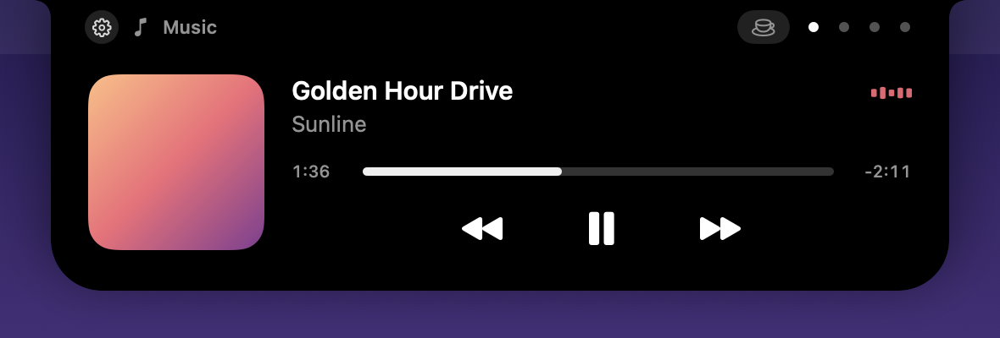
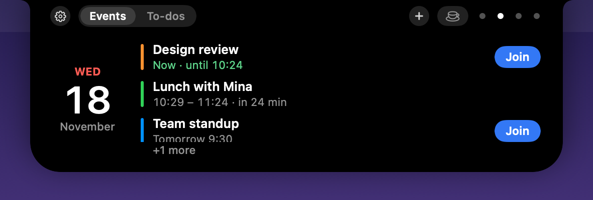
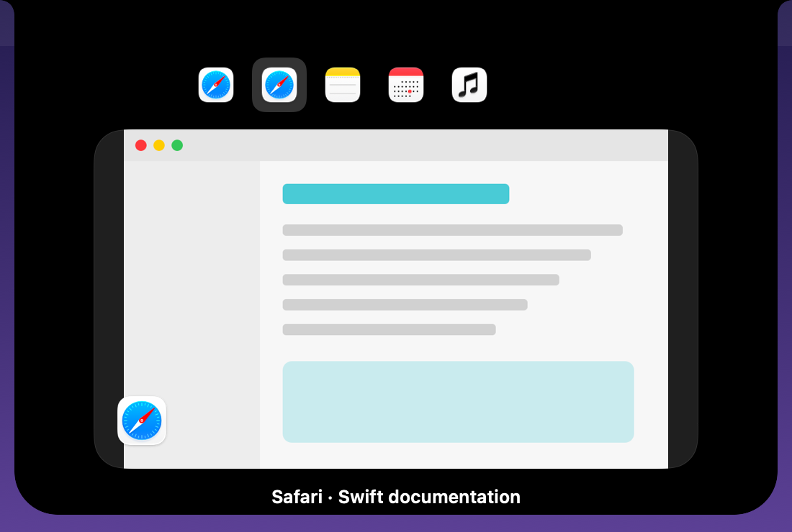
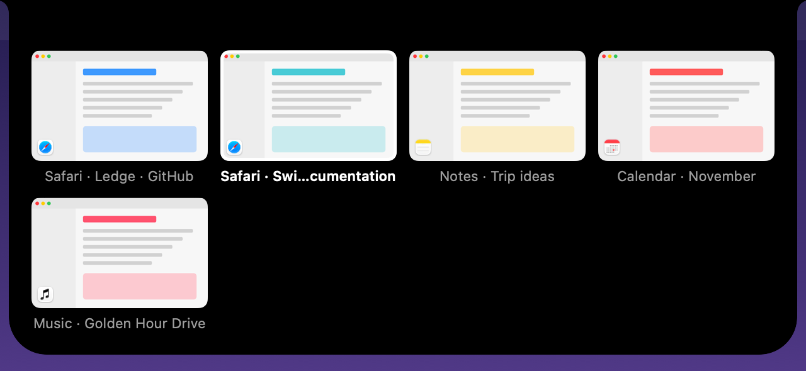

# Ledge

A Dynamic Island for your Mac's notch. Ledge turns the notch on a MacBook (or a small pill on Macs and displays without one) into a live strip for music, meetings, timers and indicators, and opens into a panel for your calendar, to-dos and notes.

<p align="center"></p>

It's free, open source (MIT) and native: Swift, SwiftUI and AppKit, with no accounts, no tracking and no network services of its own. Your calendar, to-dos and notes stay in Apple's own apps (Calendar, Reminders and Notes), so they sync to your iPhone the way they always have.

**Get it:** [download the latest release](https://github.com/sabi1125/Ledge/releases/latest) (a DMG, see [Install](#install)), or [build it from source](#build-from-source).

**Contents:** [Features](#features) · [Requirements](#requirements) · [Install](#install) · [Permissions and privacy](#permissions-and-privacy) · [Keyboard shortcuts](#keyboard-shortcuts) · [Troubleshooting](#troubleshooting) · [How it works](#how-it-works) · [Contributing](#contributing) · [License](#license)

## Features

Each feature has a short summary; open **All the details** under it for everything it does.

### Opening the island

Hover over the notch, click it, or press **⌘L** from anywhere. Its pages are **Music**, **Calendar**, **Timer** and **Notes**: swipe with two fingers, click the dots at the top right, or press **⌘1–⌘4**.

<details>
<summary><b>All the details</b></summary>

- Once open, the island stays open until you press **⌘L** or **Esc**. Moving the pointer away or clicking somewhere else never closes it, so you can work in other apps (or drag files from Finder) with it open.
- After a click elsewhere, it steps back: ⌘N, ⌘T, ⌘1–⌘4, ⌘, and Esc go to the app you clicked into until you point at the island again. ⌘L always works.
- It opens where you left it: the same page, and if you were in quick add or had a to-do open, right back there with what you typed.
- **Music** shows only when something is loaded in a player. Switch any page off in settings → Pages.
- ⌘L is taken from every app while Ledge runs, including the browser's "go to the address bar". Opening the Notes page with ⌘L or its ⌘-number puts the cursor straight into the note.
- With the trackpad tick on (settings → General), you feel a light tick as it opens. Prefer clicking? Turn off **Open on hover**.

</details>

### Music in the notch

When something plays (Apple Music, Spotify, a browser tab, anything that shows in Control Center), the notch widens to show the album art and a waveform. Open the island to scrub, pause and skip.

<p align="center"></p>

<details>
<summary><b>All the details</b></summary>

- In the closed island, a two-finger swipe skips tracks.
- The open Music page has the art, title, artist, a progress bar you can drag, and previous / play-pause / next.
- The waveform takes its color from the album art.
- Switch music off in settings → Pages if you don't want it in the notch.

</details>

### Calendar and to-dos

The Calendar page shows today's date and your next events, with **Join** for Zoom, Meet, Teams and Webex links. The **Events · To-dos** switch shows your open reminders from every list.

<p align="center"></p>

<details>
<summary><b>All the details: events</b></summary>

- Click an event to open it in the Calendar app.
- Finished events drop off, and what's next is on top: the meeting you're in, then today's meetings, then today's all-day items and anything longer than 4 hours (an "in office" block), then tomorrow the same way.
- It asks for Calendar access the first time.

</details>

<details>
<summary><b>All the details: to-dos</b></summary>

- All your open to-dos from the Reminders app, in every list. With more than 2, the island opens bigger so they all show at once (past about 7, it scrolls).
- The order: in progress first, then due today or overdue, then no due date, then upcoming (musts first within each).
- Click a circle to tick one off (Undo shows for a moment), right-click it to mark it in progress, and click a to-do to open it.
- **Steps** are checkbox lines in a to-do's notes (`- [ ] reply to the feedback`). The list shows them as **2/4**, and the to-do in progress shows its next step right under it.
- An opened to-do's notes are editable and drawn as Markdown (headings, bold, checkboxes you can tick, links), like the Notes page. Markdown links like `[docs](example.com)` show as "docs" and open on click; bare links show by their last part.
- A link in a new to-do is saved at the top of its notes (the Reminders app doesn't show links other apps save in its link field), and the ↗ opens it.
- It asks for Reminders access the first time.

</details>

**Quick add** turns one line into an event or reminder: press **⌃⌥E** (event) or **⌃⌥T** (to-do) from anywhere, or click **+**. A preview shows what Ledge understood before you press return.

| You type | You get |
| --- | --- |
| `Dentist tomorrow 3pm` | An event tomorrow at 3 pm |
| `Gunma trip jan 20 2027 to jan 25 2027` | A multi-day event |
| `Gym every weekend from 5 to 8` | A repeating 5–8 pm event on Saturdays and Sundays |
| `remind me to charge the laptop in 3 hours` | A reminder with an alarm in 3 hours |
| `! Reply to the review fri #work [30m]` | A must-do reminder due Friday, in your "work" list, with a 30 min estimate |

<details>
<summary><b>All the details: quick add</b></summary>

- **Saving:** return saves the event to your iCloud calendar (the one called Personal or Home, if there is one), or Esc cancels. With no day or time, return saves an all-day event today, and the preview says so first. After saving, **⌘Z** or Undo removes it again, and **Open in Calendar** (or **Open in Reminders**) shows what was saved.
- **Notes:** **⌘N** opens a notes box under the title (return makes a new line, **⌘return** saves, and ⌘N or Esc goes back to the title).
- **Dates:** "tomorrow", "fri", "dec 3", "2027-01-20" (ISO), "in 3 days", "next week" (Monday), and ranges like "jan 20 to jan 25" or "from 5pm dec 1 to 7pm" (a range needs "to", "until" or a dash between the two ends).
- **Times from now:** "in 3 hours", "30 min from now". In to-dos, "remind me to …" drops those words and sets an alarm, so Reminders makes a sound.
- **Repeats:** "every day", "every monday", "weekdays", "every weekend", "every 2 weeks", "monthly", "yearly", optionally "until dec 2027". The preview says how it repeats.
- **To-dos:** `!` makes it a must, a day sets the due date, `#name` picks the list whose name starts with "name" (or makes a new one, and the preview says **New list** in orange first), and `[30m]` adds a time estimate (kept at the end of the title, so it shows in Reminders too). While you type a `#`, your lists show under the line: **Tab** takes the first, a click takes any, **Esc** hides them. A list name with spaces goes in with dashes (`#Side-project`).
- If quick add closes by accident (a click elsewhere), what you typed is still there next time; Esc cancels and clears it.

</details>

### Meeting heads-up

Five minutes before a meeting, a countdown in its calendar color sits beside the notch. A minute before, a pill drops down with **Join**.

<p align="center">
  
  
</p>

<details>
<summary><b>All the details</b></summary>

- The countdown takes the place of the music or timer for those 5 minutes; on the floating pill, the title shows too.
- The pill shows the title, how soon ("in 0:42", "now", "2 min ago"), and **Join** (Zoom, Meet, Teams or Webex) or **Open** (in Calendar) for a meeting without a link, with a soft sound.
- Click the title to open the event in Calendar, or × to dismiss it. Hovering doesn't open the island over it, so you can reach Join; a click on the rest of the pill does.
- It stays until you join or dismiss it, or 5 minutes after the start.
- All-day events, declined meetings and blocks longer than 4 hours are skipped; back-to-back, the next meeting takes over.
- Turn it off in settings → Indicators, where **Try it** plays a sample meeting.

</details>

### Notes

Your notes live in Apple Notes (in a folder called **Ledge**), so they're on your iPhone too. The editor draws Markdown as you type, and **⌘E** enlarges a note into a big card in the middle of the screen for longer writing.

<p align="center"></p>

<details>
<summary><b>All the details: notes</b></summary>

- The list is on the left and the open note on the right: a **title** (the note's first line in Notes) and the text. Edits save to Notes a moment after you stop typing.
- Click the pencil or press **⌘N** for a new note (the cursor goes to its title). The sidebar button or **⌥⌘S** hides or shows the list. **Search** above the list filters by title and text.
- The trash button deletes the open note after a second click on "Delete?" (it goes to Recently Deleted in Notes, so it can be restored). **Open in Notes** opens it in the Notes app, for pictures, tables or sharing.
- **Enlarge:** the expand button or **⌘E** grows the note out of the island into a card in the middle of the screen, without the list. **Esc**, **⌘E** again, or a click outside brings it back.
- Ledge starts the Notes app hidden in the background, so it never shows up as a window or in the window switcher. The first time, macOS asks to let Ledge control Notes.
- If Notes is slow to answer (it can take several seconds after being idle), the page says so, and anything you type meanwhile is kept.

</details>

<details>
<summary><b>All the details: Markdown</b></summary>

- Drawn as you type, like Notion: `#`/`##`/`###` headings, `**bold**`, `*italic*`, `~~struck~~`, `` `code` `` in a small box, links (⌘-click opens one), bullets (●○◆◇ by indent), numbered lists, checkboxes you can click to tick, `> ` quotes with a purple bar, ```` ``` ```` blocks on a white card (typing ```` ``` ```` puts the closing one in for you), and `---` as a line.
- The marks (`##`, `**`, `` ` ``, the link address) hide, and come back on the line the cursor is on so you can edit them.
- `[] ` makes a checkbox (kept as `- [ ]` text in Notes). Return continues a list, numbered list or quote (`2.` after `1.`); return on an empty item ends the list (an empty nested one moves out a level instead); return right before an item's text pushes it down. **Tab** / **⇧Tab** indent a list line by 4 spaces. Backspace right before an item's text removes its bullet, box or `>` in one go.
- The text stays plain Markdown, so the Notes app shows the same note.

</details>

<details>
<summary><b>All the details: Vim motions</b></summary>

- Turn them on in settings → Text editor. The note opens in normal mode with a solid orange block cursor: `i`, `a`, `o` and friends start typing, and Esc goes back. The block stays steady in normal mode and blinks in insert mode, so you can tell which one you're in.
- Counts, `hjkl`, `w b e` (Japanese splits into kanji, hiragana and katakana words, like Vim), `0 ^ $`, `gg G`, `f t`, `d c y` with any motion, `dd yy p`, `x r J`, `u` / `⌃R`, `v V`, and text objects like `ciw`, `di"` and `da(` all work. `o` and `O` start a new list item below or above, like return.
- Esc in normal mode still closes the island.

</details>

### Timer and Pomodoro

A countdown timer and a Pomodoro cycle, with the time beside the notch while it runs and a pop when it ends.

<p align="center">
  
  
</p>

<details>
<summary><b>All the details</b></summary>

- **Timer:** pick a preset or add minutes, then Start. The countdown shows in orange beside the notch, and when it's done a "Timer done" pill drops down with a sound.
- **Pomodoro:** use the Timer / Pomodoro switch on the Timer page. Focus (25 min, red) and breaks (5 min, green) alternate, with a long break (15 min) after 4 focus sessions. Skip jumps to the next phase, Reset starts over, and a pop and sound mark each change.
- Lengths, the number of sessions, and auto-start are in settings → Pomodoro. Only one of the timer and the Pomodoro counts down at a time.

</details>

### Window switcher

Hold **⌥** and press **Tab** and every window comes out of the notch, with previews: two Chrome windows show as two, and windows on other desktops and in full screen are included. Four looks to pick from, like Strip and Grid:

<p align="center">
  
  
</p>

<details>
<summary><b>All the details</b></summary>

- **Keys:** keep holding ⌥ and press Tab (or → ↓) to step on, ⇧Tab (or ← ↑) to step back, and let go to switch. Return switches too, Esc cancels, and a click picks any window.
- **Shortcut:** set any shortcut in settings → Switcher, ⌘Tab included. Choosing ⌘Tab replaces macOS's app switcher while Ledge runs.
- **Looks:** Strip (the default), Grid, Focus and List, in settings → Switcher.
- It shows windows most recent first, on the screen you're using, and works between two full-screen windows of the same app.
- **Previews** need the Screen Recording permission; without it, the switcher shows app icons. Previews are taken of windows you can see, refreshed as you leave an app, and kept in memory only.
- It needs Accessibility, like the volume keys. Quit other switchers (AltTab, BetterCmdTab and the like) first, or they take the keys before Ledge does.

</details>

### Tray

Drop up to 5 files or folders on the notch to keep them handy, then drag them out anywhere. **⌃⌥F** shows the tray.

<details>
<summary><b>All the details</b></summary>

- As a Finder drag gets near the top of the screen, the notch grows into a drop target; let go and a pop says what it holds ("Holding 2 files in tray"). You can also drop on the open island, on any page.
- The tray stays hidden: **⌃⌥F** shows it under the page you're on (again to hide; it also hides when the island closes). While hidden, a small tray and the count sit beside the page dots; click it to show the tray.
- Hover an item for its name, size, kind and folder. Drag it out to drop a copy anywhere (it stays in the tray), double-click to open it, × removes it, and right-click has Quick Look, Show in Finder, Remove and Clear All.
- It holds 5 at a time: for more, put them in a folder and drop the folder.
- The tray only points at your files, so they stay where they are, and it remembers them after a restart (a file you moved or deleted drops off). Turn it off in settings → Pages.

</details>

### Indicators and stay awake

Volume, brightness, charging and low battery show in the notch instead of the macOS pop-ups. The coffee cup keeps your Mac awake, like `caffeinate`.

<p align="center"></p>

<details>
<summary><b>All the details</b></summary>

- **Volume and brightness keys:** Ledge handles them itself, so only its indicator appears. This needs Accessibility; without it, the keys work as usual with the macOS pop-up. ⇧⌥ + key changes the level in smaller steps.
- **Battery:** a pop when you plug in the charger, and at 20%, 10% and 5%.
- **Stay awake:** click the coffee cup in the open island's top bar for your default length, or right-click or hold it to choose 15 min, 30 min, 1 h, 2 h, or until you turn it off. It turns orange with the time left, and a short pop shows when it starts and ends. In settings → Stay awake you can choose the default length, whether the screen stays on too, and whether to stay awake automatically while charging. Closing the lid still sleeps the Mac.
- Switch each indicator on or off in settings → Indicators.

</details>

### External displays and Macs without a notch

Screens without a notch get a floating pill at the top center, like the iPhone's Dynamic Island, with the same features.

<p align="center"></p>

<details>
<summary><b>All the details</b></summary>

- The pill stays visible on normal desktops and is kept off full-screen desktops (apps and videos), so it never flickers when you swipe. On a full-screen desktop, rest the pointer at the top edge and it fades in with the menu bar. ⌘L, quick add and settings bring it in too.
- The notch island on a MacBook screen stays put on full-screen desktops, where the strip beside the notch is black anyway. The pill also hides during Mission Control.
- Turn the pill off with **Show on other displays** in settings → General. With the lid closed (only external displays), the main display always gets the pill, even with that setting off.
- Plugging a display in or out adds or removes its island.

</details>

### Settings and animations

Click the gear in the open island, or press **⌘,**. Settings opens inside the island.

<details>
<summary><b>All the details</b></summary>

- You can also open settings by opening Ledge from Spotlight or the Applications folder, or by right-clicking the island and choosing Ledge Settings. Close it with ✕, Done, Esc or ⌘L.
- Sections: **Pages**, **Indicators**, **Animation**, **Switcher**, **Pomodoro**, **Stay awake**, **Text editor** (Vim motions) and **General** (open at login, open on hover, trackpad tick, other displays, updates, quit).
- **Animation styles:** Calm (the default), Stretch, Drop down, and Morph and blur. Picking one replays the settings panel in that style. In every style the content only fades, so nothing shrinks or zooms.

</details>

### A clean menu bar

Remove other apps' icons in **System Settings → Menu Bar** (there's a button in Ledge's settings): turn off every app, and of Apple's icons keep only **Wi-Fi** and **Battery**.

<details>
<summary><b>All the details</b></summary>

- Ledge also has an optional **Hide other apps' menu bar icons** setting (off by default). It squeezes icons into macOS's hidden-items overflow and leaves macOS's overflow chevron showing, so it's only useful for apps that can't be turned off in System Settings.
- When it's on, it needs Accessibility, and **⌃⌥⌘M** shows the hidden icons for 8 seconds.

</details>

## Requirements

- A Mac with Apple silicon and macOS 15 or later:
  - **MacBooks with a notch** (MacBook Pro 14" and 16", MacBook Air M2 and later) get the island in the notch.
  - **Other Apple silicon Macs** (MacBook Air M1, 13" MacBook Pro, iMac, Mac mini, Mac Studio) and **external displays** get the floating pill, with the same features.
  - Intel Macs and macOS 14 or older aren't supported.
- To build it: **Xcode** (free on the App Store), opened once so it finishes setting up. The Command Line Tools alone can't build it, because SwiftUI's macros come with Xcode.
- So far Ledge has been tested on a MacBook Pro with a notch and an external display, on macOS 27, built with Xcode 27 (Swift 6.4). If you run it on another Mac or macOS version, an issue saying how it went helps a lot.


## Install

### Download

1. Download **Ledge-x.y.z.dmg** from the [latest release](https://github.com/sabi1125/Ledge/releases/latest), open it, and drag **Ledge** onto **Applications**.
2. Open Ledge from Applications. macOS says it can't verify the app and won't open it, because Ledge isn't notarized by Apple (that needs a paid Apple Developer ID). Click **Done**.
3. Open **System Settings → Privacy & Security**, scroll down to the message about Ledge, and click **Open Anyway**. Confirm with your password or Touch ID. You only do this once per version.

Ledge then asks for the permissions it needs (see below), and opens at login (switch that off with **Open at login** in settings → General). To **update**, use **Check for updates** in settings → General: it tells you when there's a new release, and **Download** opens its page.

Each downloaded version is signed ad hoc, so macOS treats it as a new app: after updating, you may need to switch Ledge off and on again in Privacy & Security → Accessibility (and Screen Recording).

### Build from source

You need **Xcode** (see [Requirements](#requirements)).

```bash
git clone https://github.com/sabi1125/Ledge.git
cd Ledge
scripts/install.sh
```

`install.sh` builds Ledge, puts it in `/Applications`, and opens it; a first build takes a few minutes. To **update**, use **Check for updates** in settings → General, which pulls the latest version and reinstalls it, or run `scripts/install.sh` again.

### Signing your builds (recommended)

macOS ties permissions like Accessibility to an app's signature. Without a signing certificate, Ledge is signed ad hoc, and every new build looks like a different app to macOS, so you'd grant Accessibility again after each update. To avoid that, make a free self-signed certificate once:

1. Open **Keychain Access**, then choose **Keychain Access → Certificate Assistant → Create a Certificate…**
2. Name it exactly **Ledge Local Signing**, set **Certificate Type** to **Code Signing**, and click **Create**.
3. Build again with `scripts/install.sh`. The build finds the certificate by its name and uses it from then on.

The first build with it may ask whether `codesign` can use the key; click **Always Allow**. If the build stops with `errSecInternalComponent`, see [Troubleshooting](#troubleshooting).

## Permissions and privacy

Ledge asks only for what a feature needs, and each feature works without the others.

| Permission | Used for | Without it |
| --- | --- | --- |
| Accessibility | The window switcher, the volume and brightness keys, the menu bar hider | Those features stay off; the keys work as usual with the macOS pop-ups |
| Screen Recording | Window previews in the switcher | The switcher shows app icons |
| Calendar | Events, quick add, the meeting heads-up | The Calendar page asks for access |
| Reminders | To-dos | The To-dos side asks for access |
| Automation (Notes) | The Notes page reads and writes the "Ledge" folder in Apple Notes | The Notes page explains how to allow it |

What stays where:

- Ledge has no servers, accounts or analytics. The only network request it makes itself is when you click **Check for updates**: one request to GitHub for the latest release (downloaded copies), or `git fetch` (copies built from source).
- Window previews are kept in memory and never saved to disk.
- The log (`~/Library/Logs/Ledge.log`) records problems only, unless you turn on verbose logging. Remove titles before sharing it, since it can include window, song or event names.

## Keyboard shortcuts

**Anywhere**

| Shortcut | What it does |
| --- | --- |
| ⌘L | Open or close the island |
| ⌃⌥E | Quick add an event |
| ⌃⌥T | Quick add a to-do |
| ⌃⌥F | Show or hide the tray |
| ⌥Tab | Window switcher (set your own in settings, ⌘Tab included) |
| ⌃⌥⌘M | Show the hidden menu bar icons for 8 seconds (with the menu bar hider on) |

**While the island is open**

| Shortcut | What it does |
| --- | --- |
| ⌘1–⌘4 | Go to a page, in the order of the dots |
| Two-finger swipe | Next or previous page |
| ⌘, | Settings |
| Esc | Step back (out of a to-do, quick add or the enlarged note), or close the island |

**Music**

| Shortcut | What it does |
| --- | --- |
| Two-finger swipe on the closed island | Skip to the next or previous track |

**Calendar and to-dos**

| Shortcut | What it does |
| --- | --- |
| ⌘N | New event (or new to-do in To-dos mode) |
| ⌘T | New to-do (on the to-do list) |
| Click a circle / right-click it | Tick a to-do off / mark it in progress |

**Quick add**

| Shortcut | What it does |
| --- | --- |
| Return | Save |
| ⌘N | Open the notes box (⌘N or Esc goes back to the title) |
| ⌘Return | Save, from the notes box |
| Tab | Take the first suggested list while typing a `#` |
| Esc | Hide list suggestions, leave the notes box, or cancel |
| ⌘Z | Undo the last save |

**Notes**

| Shortcut | What it does |
| --- | --- |
| ⌘N | New note |
| ⌘E | Enlarge the note, or put it back |
| ⌥⌘S | Show or hide the notes list |
| Tab / ⇧Tab | Indent or outdent a list line |
| ⌘-click | Open a link |
| Esc | Back from the enlarged note into the island |

**Window switcher** (while holding its modifier)

| Shortcut | What it does |
| --- | --- |
| Tab, → or ↓ | Next window |
| ⇧Tab, ← or ↑ | Previous window |
| Let go, or Return | Switch to the chosen window |
| Esc | Cancel |

⌘L is taken from every app while Ledge runs, including the browser's "go to the address bar".

## Troubleshooting

**The build stops with "✗ Signing failed" and `errSecInternalComponent`.** macOS wants your permission for `codesign` to use the certificate. Click **Always Allow** if a keychain prompt shows, or allow it for good by running this once (it asks for your login password):

```bash
security set-key-partition-list -S apple-tool:,apple:,codesign: -s ~/Library/Keychains/login.keychain-db
```

**The build fails with "plugin for module 'SwiftUIMacros' not found", or says this Mac can't build SwiftUI apps yet.** The Mac has the Command Line Tools but not Xcode. Install Xcode from the App Store, open it once, and build again. If Xcode is installed somewhere other than `/Applications`, point macOS at it with `sudo xcode-select -s /path/to/Xcode.app`.

**The build fails with "Could not initialize build system" or "Unknown error parsing property list".** Swift's build engine couldn't start, usually because Xcode or the Command Line Tools aren't fully set up. The build script then retries with Swift's older build engine by itself. If it still fails, finish setting up Xcode and build again:

```bash
sudo xcodebuild -license accept
xcodebuild -runFirstLaunch
```

To use the older engine straight away: `LEDGE_BUILD_SYSTEM=native scripts/install.sh`.

**macOS says Ledge can't be opened or can't be verified.** That's Gatekeeper, because Ledge isn't notarized. Follow step 3 of [Download](#download): System Settings → Privacy & Security → **Open Anyway**.

**A downloaded copy shows no music, or a part of it is blocked.** If something inside Ledge is still marked as downloaded after Open Anyway, you can clear that mark for Ledge only (this is your call: it tells macOS you trust this copy):

```bash
xattr -dr com.apple.quarantine /Applications/Ledge.app
```

**A permission keeps getting asked for again after every update.** Downloaded copies and builds without a certificate are signed ad hoc, so each version looks new to macOS. If you build from source, make the certificate in [Signing your builds](#signing-your-builds-recommended).

**The switcher or the volume keys don't react.** Check System Settings → Privacy & Security → Accessibility, and switch Ledge off and on again there (each ad-hoc build needs a new grant). Quit other window switchers (AltTab, BetterCmdTab…), since the first app to catch the keys wins.

**Something stopped working after a macOS update.** Some features rely on private macOS functions, which an update can change. Ledge checks them at launch and logs what's missing:

```bash
grep "private APIs" ~/Library/Logs/Ledge.log | tail -1
```

**The Notes page says it's waiting for the Notes app.** Notes can take several seconds to answer after it's been idle; Ledge keeps anything you type meanwhile.

**More detail in the log.** Turn on verbose logging, restart Ledge, and look at `~/Library/Logs/Ledge.log`:

```bash
defaults write local.sabir.ledge verboseLog -bool true
```

**Uninstalling.** Quit Ledge (right-click the notch → Quit Ledge), delete `/Applications/Ledge.app`, and remove it from System Settings → General → Login Items.

## How it works

- `Sources/Ledge` is the app: a borderless panel over the notch on each screen, the island views (SwiftUI), and monitors for volume, brightness, battery, displays and full-screen desktops (AppKit).
- `Sources/LedgeCore` holds the logic that has no UI, such as the quick add parser, the island layout, Vim motions, Markdown styling and the meeting schedule. It's covered by unit tests: `swift test`.
- `Bridge/` reads what's playing. macOS only shares now-playing information with Apple-signed programs, so Ledge loads a small library into `/usr/bin/perl` (which is Apple-signed) to read it. Other notch apps use the same workaround.
- **Private APIs.** The window switcher, the brightness keys and keeping the external pill off full-screen desktops use undocumented macOS functions. They're all listed in `Sources/Ledge/PrivateAPIs.swift`, checked at launch, and each feature turns itself off if its function is missing. Because of this, Ledge can't go on the Mac App Store.
- `Ledge --snapshot DIR` (from `.build/debug/Ledge` after `swift build`) draws every island state to images with sample data. That's how the screenshots in this README were made.

## Contributing

Bug reports, ideas and pull requests are welcome; see [CONTRIBUTING.md](CONTRIBUTING.md). Issues are public, so leave your own window, song, event and note titles out of them.

## License

[MIT](LICENSE) © 2026 sabir. Ledge isn't affiliated with Apple; "Dynamic Island" is Apple's name for the iPhone feature that inspired it.
